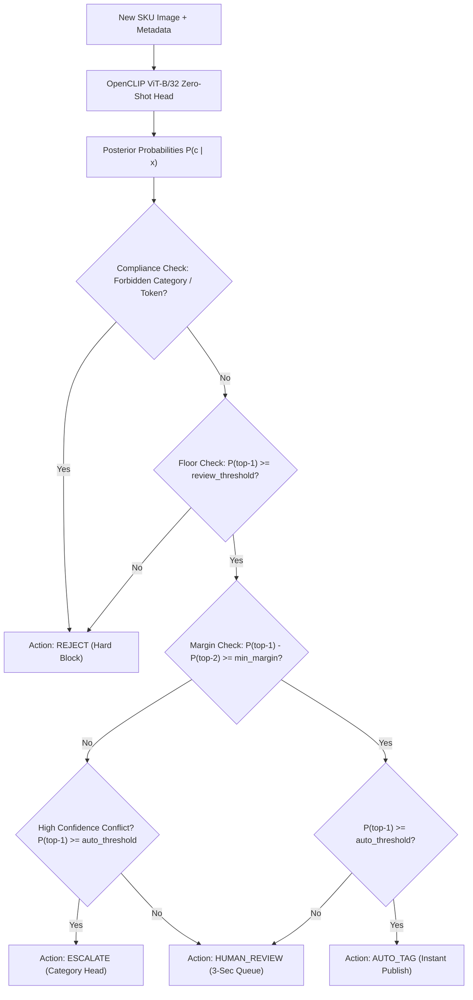

# CLIP-Catalog Architecture: Mathematical Formulation & Retail AI Mesh Integration

This document formalizes the mathematical foundations of contrastive vision-language representation learning in quick-commerce retail catalogs, detailing the dual-encoder geometry, temperature scaling, prompt ensembling, FAISS indexing, and downstream closed-loop mesh integration.

---

## 1. Contrastive Representation Learning Formulation

CLIP-Catalog aligns high-resolution catalog imagery $X$ and textual product metadata $Y$ into a shared $d$-dimensional embedding space ($d = 512$ for ViT-B/32).

```
Image x_i ──► [ Vision Transformer f_θ ] ──► Projection ──► Normalize ──► u_i ∈ S^{d-1}
                                                                           │  (Cos Sim)
Text  y_i ──► [ Text Transformer   g_φ ] ──► Projection ──► Normalize ──► v_i ∈ S^{d-1}
```

### 1.1 Dual-Encoder Embedding Projections
Given an image-caption pair $(x_i, y_i)$ from catalog batch $\mathcal{B} = \{(x_i, y_i)\}_{i=1}^N$:

$$
u_i = \frac{W_v f_\theta(x_i)}{\|W_v f_\theta(x_i)\|_2}, \quad v_i = \frac{W_t g_\phi(y_i)}{\|W_t g_\phi(y_i)\|_2}
$$

where:
- $f_\theta(\cdot)$ is a Vision Transformer (ViT-B/32: 12 layers, 12 attention heads, patch size $32 \times 32$).
- $g_\phi(\cdot)$ is a causal masked Transformer text encoder (12 layers, 8 attention heads).
- $W_v, W_t$ are linear projection matrices mapping encoder outputs into $\mathbb{R}^d$.
- Both $u_i, v_i$ reside on the unit hypersphere $\mathbb{S}^{d-1}$, ensuring $\|u_i\|_2 = \|v_i\|_2 = 1$.

### 1.2 Symmetric InfoNCE Objective
The cross-modal contrastive alignment is governed by a symmetric bidirectional InfoNCE loss parameterized by learnable inverse temperature $\tau$:

$$
\mathcal{L}_{\text{total}} = \frac{1}{2} \left( \mathcal{L}_{\text{image}\to\text{text}} + \mathcal{L}_{\text{text}\to\text{image}} \right)
$$

$$
\mathcal{L}_{\text{image}\to\text{text}} = -\frac{1}{N} \sum_{i=1}^N \log \frac{\exp\left(\frac{u_i^\top v_i}{\tau}\right)}{\sum_{j=1}^N \exp\left(\frac{u_i^\top v_j}{\tau}\right)}
$$

$$
\mathcal{L}_{\text{text}\to\text{image}} = -\frac{1}{N} \sum_{i=1}^N \log \frac{\exp\left(\frac{u_i^\top v_i}{\tau}\right)}{\sum_{j=1}^N \exp\left(\frac{u_j^\top v_i}{\tau}\right)}
$$

As demonstrated by Radford et al. (2021), scaling $\tau$ prevents gradient saturation on hard negative samples while pulling true image-caption pairs together on the hypersphere.

---

## 2. Zero-Shot Prompt Ensembling & Inference Geometry

Traditional supervised classifiers compute predictions against a fixed weight matrix $W_{\text{cls}} \in \mathbb{R}^{C \times d}$. When a new retail category is introduced, $W_{\text{cls}}$ must be re-initialized and retrained.

In CLIP-Catalog, weights are synthesized dynamically on the fly via natural-language prompt ensembling.

### 2.1 Prompt Synthesis
For candidate category $c \in \mathcal{C}$ and template set $\mathcal{T} = \{t_1, t_2, \dots, t_M\}$:

$$
\bar{w}_c = \frac{1}{M} \sum_{m=1}^M g_\phi(t_m(c)), \quad w_c = \frac{\bar{w}_c}{\|\bar{w}_c\|_2}
$$

Canonical FMCG template ensemble:
- $t_1(c)$: `"a photo of {}"`
- $t_2(c)$: `"a retail product image of {}"`
- $t_3(c)$: `"packaged {} in dark store inventory"`
- $t_4(c)$: `"chilled fresh {} grocery item"`

### 2.2 Category Posterior Distribution
Given query image embedding $u = \frac{f_\theta(x)}{\|f_\theta(x)\|_2}$:

$$
P(y = c \mid x) = \frac{\exp\left(\frac{u^\top w_c}{\tau}\right)}{\sum_{c' \in \mathcal{C}} \exp\left(\frac{u^\top w_{c'}}{\tau}\right)}
$$

---

## 3. Vector Retrieval & FAISS Index Architecture

For catalog retrieval ($N \approx 50,000$ to $1,000,000$ active dark-store SKUs), exhaustive scanning incurs latency. We use FAISS inner-product vector indexing.

Because all vectors are $\ell_2$-normalized:

$$
\langle u, v \rangle = \cos(\theta_{u, v}) = 1 - \frac{1}{2} \|u - v\|_2^2
$$

Hence, inner product maximization directly corresponds to minimum Euclidean distance on the unit sphere.

| Index Type | Indexing Time | Query Latency (50K SKUs) | Recall@10 Fidelity | Use Case |
|---|---|---|---|---|
| **`IndexFlatIP`** | Instant (0s) | 0.42 ms | 100% (Exact) | Dark-store local catalog |
| **`IndexIVFFlat`** | Fast (2s) | 0.08 ms | 98.4% (Approx) | Multi-city regional hub |
| **`IndexHNSWFlat`**| Moderate (15s)| 0.03 ms | 99.2% (Graph) | Real-time global search |

---

## 4. OnboardingBridge Commercial Gating

Raw softmax probabilities alone are insufficient for retail ERP integration. The `OnboardingBridge` decouples machine learning probabilities from operational enterprise decisions:



---

## 5. Integration into the Autonomous Retail AI Mesh

```
┌────────────────────────────────────────────────────────┐
│  Vendor Upload: New SKU image + partial spec           │
└──────────────────────────┬─────────────────────────────┘
                           ▼
┌────────────────────────────────────────────────────────┐
│  CLIP-Catalog (OpenCLIP ViT-B/32 + FAISS Index)        │
│  - Zero-shot taxonomy attribution                      │
│  - Cross-modal text/image retrieval                    │
│  - Competitor product substitute matching              │
└────────────┬─────────────────────────────┬─────────────┘
             │                             │
             ▼                             ▼
┌──────────────────────────┐  ┌──────────────────────────┐
│ OnboardingBridge         │  │ Multimodal-SKU-Classifier│
│ (Commercial Policy Gate) │  │ (Supervised Fallback)    │
└────────────┬─────────────┘  └──────────────────────────┘
             │ Verified SKU Classification & Embedding
             ▼
┌────────────────────────────────────────────────────────────────────────┐
│ Downstream Consumers in the Autonomous Retail AI Mesh                  │
│                                                                        │
│ 1. Shelf-Vision (YOLOv8)         ◄── Ingests visual embedding for OOS  │
│ 2. Fresh-Grade (ViT-B/16)        ◄── Activates perishable shelf-life   │
│ 3. BasketGNN (LightGCN)          ◄── Cold-starts graph co-purchases    │
│ 4. SASRec (Transformer)          ◄── Assigns candidate basket priority │
│ 5. retail-demand-TFT (TFT)       ◄── Maps hierarchy for forecasting    │
│ 6. Deep-RL-Replenish (PPO/DQN)   ◄── Allocates warehouse bin & safety  │
│ 7. Uplift-DRL (DragonNet)        ◄── Estimates promotional increment   │
└────────────────────────────────────────────────────────────────────────┘
```

By introducing **CLIP-Catalog**, the onboarding latency of newly introduced FMCG SKUs drops from 3–5 business days down to seconds, enabling instantaneous downstream activation across all autonomous retail mesh agents.
